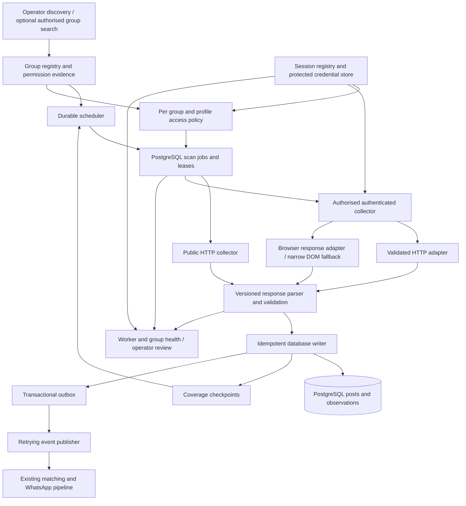

# Facebook Group collection: feasibility and architecture investigation

Research date: **4 November 2026**. Decision status: **architecture proposal; implementation withheld pending review**.

## Scope and evidence

This investigation covers collection only. It does not change classification, BNI matching, scoring or WhatsApp delivery. No scraper was implemented, no dependency installed, no Facebook account used, no membership request submitted and no live group collection performed. Existing application files were only read. The repository already has unrelated working changes; these were left intact.

Evidence labels used throughout:

- **S — Verified from source code:** the inspected revision implements the stated behavior. This does not establish that Facebook currently accepts it.
- **L — Verified through a live test:** reserved for an experiment actually run against Facebook. **There are no L findings about group collection in this report.**
- **D — Documented but not independently tested:** maintainer reports, platform or library documentation.
- **P — Technically plausible:** a proposed design, assumption or model requiring validation.
- **U — Unsupported or disproven:** insufficient evidence, or contradicted by inspected code.

GitHub repository discovery used multiple searches covering groups, GraphQL, Playwright, asynchronous scraping and monitoring. Nine repositories were inspected to different depths, including older projects and code updated in 2026. The [source manifest](facebook-collection-source-manifest-2026-11-04.json) records exact revisions and distinguishes repository push times from commits touching inspected implementation files. Dates below refer to the latter, not stars, README activity or dependency bots. This is a substantial targeted review, not an exhaustive census of GitHub or every fork.

## A. Executive findings

**A self-hosted monitoring service is feasible engineering. A reliable, unattended feed of every new post from arbitrary hundreds or thousands of Facebook Groups is not established by the available evidence.** The main uncertainties are permission, sustained access and feed completeness, rather than CPU or database capacity. Treat the desired scale as a hypothesis to validate, not an implementation promise.

| Question | Finding | Evidence class |
|---|---|---|
| Can public groups be read anonymously? | Some implementations parse anonymous Comet/Relay HTML and replay page-provided discussion operations. Neither all groups nor sustained anonymous access is demonstrated here. | S/D, not L |
| When is authentication needed? | Whenever the anonymous route is login-walled, and for member-only discussion available to an authorised member. Session possession does not grant collection or redistribution permission. | D/P |
| What does fbcli solve? | Cookie import, disposable Playwright context creation, bounded DOM reads, group search and a basic Join click. It is an interactive automation utility, not a continuous incremental collector. | S |
| Is direct HTTP practical? | Worth testing first: contemporary source implements group GraphQL pagination. One newer Python project requests chronological ordering. Sustained acceptance and completeness remain unknown. | S/P |
| Best architecture? | Independent Python collection service; HTTP adapter where validated; browser-response adapter where permitted and necessary; PostgreSQL queue, idempotent posts, separate coverage checkpoint and transactional outbox. | P |
| Why imperfect reliability? | Ranked/incomplete feeds, moderation delays, login walls, session expiry, schema changes, truncated content, missing identity/time fields, and permission revocation. | S/D/P |
| First validation? | Paired HTTP versus browser-response capture on three expressly permitted public groups; establish actual feed records, identities and pagination before expanding to 10–20 groups. | P |

**Permission is a separate feasibility constraint.** Meta publicly states that automated collection without its permission violates its terms. Group-admin permission and legitimate membership do not substitute for platform permission. The current Automated Data Collection Terms URL returned a login/block page through the research fetcher; its exact current text was therefore not independently verified. Do not interpret an accessible group or a successful request as authorisation. Private-group commercial redistribution needs particularly explicit scope. [Meta explanation](https://about.fb.com/news/2021/04/how-we-combat-scraping/), [current terms endpoint](https://www.facebook.com/legal/automated_data_collection_terms). **D; current detailed terms unresolved.**

The historical Groups API was retired in 2024, with removal commonly dated 22 April. The official [v19 announcement](https://developers.facebook.com/blog/post/2024/01/23/introducing-facebook-graph-and-marketing-api-v19/) and [changelog](https://developers.facebook.com/docs/graph-api/changelog/version19.0/) were inaccessible to this research fetcher (fetch error/429). Accordingly, the exact retirement date is background requiring re-verification, not a newly confirmed fact here. More significantly, **no current generally available official API or webhook for this commercial arbitrary-group monitoring use case was verified**. Do not plan around an obsolete Groups API or imply that admin app installation restores it.

## B. fbcli: actual implementation

Inspected revision: [`863927514db22c4443e8d815530ab558c6df8c03`](https://github.com/0xEnc0der/fbcli/tree/863927514db22c4443e8d815530ab558c6df8c03). MIT. The principal implementation files were last changed on 26 July 2026; a subsequent repository push is not evidence of a new reader.

### Ten requested questions

| Question | Source-grounded answer |
|---|---|
| 1. Arbitrary public groups? | `group_feed()` accepts a group reference and navigates there, but all commands require cookies. No anonymous group reader or guarantee of arbitrary-group access exists. |
| 2. Member groups? | The injected user session can navigate to a group it can access; the same reader attempts extraction. It does not independently verify membership, private access or collection permission. |
| 3. DOM or responses? | Group/feed reading uses `div[role="article"]` and `inner_text()`. The response listener is in the publication path for discovering the newly created post URL. It is not a network feed reader. |
| 4. Bounded? | Default group limit 10; `_collect_articles(..., scrolls=6)` inspects up to six passes. Increasing the post limit does not remove the scroll bound. |
| 5. Chronological? | No sort selector, chronological query parameter or chronological validation in `group_feed()`. |
| 6. Avoid old posts? | Only an in-call `seen` set, keyed by permalink or the first 80 characters of article text. Nothing persists between calls. |
| 7. Reusable library code? | Cookie-format normalization, browser lifecycle and small navigation/action functions are importable Python. The Post dataclass is author/text/permalink only, insufficient as the proposed event contract. |
| 8. New browser per command? | Yes for ordinary CLI invocations: `run()` enters `Browser`, launches Chromium, creates context/page and closes them at exit. |
| 9. Reuse context? | Multiple action functions can share one already-entered fbcli `Browser` object. An externally managed Playwright context is not an accepted constructor argument; injection needs refactoring or a wrapper matching its interface. |
| 10. Limits? | No durable scheduler, cursor checkpoints, publication timestamps, stable source IDs, coverage proof, transactional delivery, permissions registry or robust member-access classification. |

These answers are **S**, with live compatibility explicitly untested. Primary evidence: [`web_actions.py`](https://github.com/0xEnc0der/fbcli/blob/863927514db22c4443e8d815530ab558c6df8c03/fbcli/web_actions.py), [`cli.py`](https://github.com/0xEnc0der/fbcli/blob/863927514db22c4443e8d815530ab558c6df8c03/fbcli/cli.py).

### Browser, session and error behavior

`browser.py` accepts extension JSON, simple JSON mappings, Netscape files and inline cookie headers, requires `c_user` and `xs`, and maps cookies into a fresh context. It does not save renewed cookie/storage state on exit. Netscape loading ignores expiry during import and does not preserve all original attributes. Domain validation should be stricter before reuse. Inline secrets risk shell history and process-list exposure; prefer a protected credential reference.

The login guard checks the navigation URL for login/checkpoint strings. It does not establish that an HTTP-200 page contains an accessible discussion or distinguish membership loss from selector drift. `settle()` tolerates network-idle timeouts. The launch arguments include disabled sandboxing and an automation-related browser flag; do not copy those defaults into the proposed system. Use normal maintained Playwright browser defaults, and stop on access restrictions. [`browser.py`](https://github.com/0xEnc0der/fbcli/blob/863927514db22c4443e8d815530ab558c6df8c03/fbcli/browser.py). **S.**

### Discovery and membership

`search(..., kind="groups")` performs a browser search, scrolls three times, inspects a bounded set of links and returns limited text/URL results. It is a candidate discovery convenience, not a complete geographic directory or entitlement inventory.

`join_group()` clicks a button named Join/Join group, waits and returns a message saying it was clicked. It does **not** enumerate questions, prepare truthful responses, submit a question form, verify pending status or prove approval. Even a successful click may leave an incomplete application. Use operator-assisted admission; do not rely on this return string as membership evidence. [`search()` and `join_group()` source](https://github.com/0xEnc0der/fbcli/blob/863927514db22c4443e8d815530ab558c6df8c03/fbcli/web_actions.py). **S.**

**Decision on fbcli:** do not extend it into the production core. Its bounded synchronous DOM reader is the approach being replaced. Reuse selected MIT helper ideas after hardening, retain a pinned copy as a comparator or supplementary operator tool if useful, and exclude write actions from collector workers. No reason to inherit its posting, messaging and reaction capabilities.

## C. Open-source comparison and ranking

Ranking measures usefulness for this investigation and reuse, **not proven live reliability**. None was run against Facebook in this investigation; no independent throughput benchmark was found in the inspected code. Private-group support always means only content available to a permitted session, never automatic access.

| Rank / repository | Licence; inspected code update | Technique and authentication | Groups and pagination | Structured fields; performance/reliability; reuse |
|---|---|---|---|---|
| 1. [XD-MHLOO/facebook-gql-scraper](https://github.com/XD-MHLOO/facebook-gql-scraper) | MIT; 2026-11-03 | Synchronous `requests.Session`; cookie JSON; dynamically discovers operation IDs from page JavaScript | Group iterator; cursor + page info; explicitly requests `CHRONOLOGICAL`. Public/member-group behavior not live demonstrated here | ID, URL, text, creation time, attachments and counts. Strongest Python HTTP candidate, but young, broad and unbenchmarked. Reuse parser/iterator concepts behind adapter; harden before execution. |
| 2. [tamnd/facebook-cli](https://github.com/tamnd/facebook-cli) | Apache-2.0; group implementation 2026-07-29 | Go HTTP; anonymous or imported session; Comet HTML/Relay decoding and page-provided operation replay | Group shell and feed; cursor machinery; author explicitly documents signed-out fragility | Group/post records, cursor and field provenance. Best inspected reference for HTML bootstrap and streamed payload stitching. Go, not drop-in Python. Capture fixtures prove parser intent, not current service access. |
| 3. [FaustRen/facebook-graphql-scraper](https://github.com/FaustRen/facebook-graphql-scraper) | MIT; 2026-08-18 | Selenium network capture, then `requests.post` pagination; optional account login | Inspected core emphasizes user/profile feeds, not a demonstrated general group collector | IDs/text/timestamps/reactions with dataframe conversion. Useful browser-assisted capture/replay comparator, not basis for group support claims. Full rendering initially remains necessary. |
| 4. [0xEnc0der/fbcli](https://github.com/0xEnc0der/fbcli) | MIT; 2026-07-26 | Sync Playwright, required cookies | Public/member-visible group navigation attempted; six DOM passes, default ten posts | Author/text/permalink; no timestamps/checkpoints. Reuse small helpers, comparator only. |
| 5. [mohdtalal3/facebook_post_comment_scraper](https://github.com/mohdtalal3/facebook_post_comment_scraper) | MIT; group code 2026-10-05 | Sync HTTP GraphQL; cookies/request token configured externally | Group cursor loop; hard-coded operation ID; date filter assumes newest-first without setting sort | Post ID/text/time/permalink/media/counts, batched callbacks and stored-post existence checks. Most concrete minimal group request reference; unsafe chronological early stop and proxy-rotation retry logic make wholesale reuse unsuitable. |
| 6. [thanh2004nguyen/facebook-group-scraper](https://github.com/thanh2004nguyen/facebook-group-scraper) | MIT; 2025-06-26 | Playwright with saved storage state; headed | One configured group; target 50 posts, max 30 scrolls | Text file; in-run text dedup only. Vietnamese See more selector. Simple baseline; not durable incremental infrastructure. |
| 7. [kevinzg/facebook-scraper](https://github.com/kevinzg/facebook-scraper) | MIT; inspected pagination 2023-02-17; repo push 2024-06-22 | Requests/HTML; mobile/mbasic surfaces; anonymous/cookies historically | Group URL and HTML cursor extraction exist | Historically rich fields and fixtures. Legacy interface dependency; no current compatibility demonstrated. Do not select because of popularity or old tutorials. |
| 8. [wael-sudo2/facebook-page-info-scraper](https://github.com/wael-sudo2/facebook-page-info-scraper) | MIT; fetch module 2026-10-12 | HTTP page fetch; additional browser/enrichment features described | Business Page metadata is its target; group-feed pagination not established | Useful bounded-response fetch/wall classification ideas. A Page metadata result is not evidence of group post monitoring. Reject “unlimited” as a throughput guarantee. |
| 9. [csabapalfi/facebook-scrape-group](https://github.com/csabapalfi/facebook-scrape-group) | No licence detected in metadata/tree; index code 2020-01-30; push 2022-12-10 | JavaScript browser/DOM observer and scroll flow | Old group-feed permalink capture | URLs/date extraction concepts, no current operational evidence. Avoid implementation reuse without a licence and avoid legacy selectors. |

Implementation evidence: [Python GraphQL context](https://github.com/XD-MHLOO/facebook-gql-scraper/blob/3933a99a4eaac2e04754165b0ad7582b1ba452e9/facebook_gql_scraper/facebookGraphql.py), [iterator/models](https://github.com/XD-MHLOO/facebook-gql-scraper/blob/3933a99a4eaac2e04754165b0ad7582b1ba452e9/facebook_gql_scraper/structures.py), [Go group parser](https://github.com/tamnd/facebook-cli/blob/f50ef61d4d8444d7902f5c15791b097f49e72e5e/fb/group.go), [hybrid request flow](https://github.com/FaustRen/facebook-graphql-scraper/blob/6ad87844786da85ecf4c50b07a6ec8258e1b8048/fb_graphql_scraper/facebook_graphql_scraper.py), [minimal group HTTP loop](https://github.com/mohdtalal3/facebook_post_comment_scraper/blob/0c33360a15c1df52712b8abeaa13d38e79cc7ba5/scraper/group_posts.py), [bounded DOM example](https://github.com/thanh2004nguyen/facebook-group-scraper/blob/7d7cc96e203c12ca191375453ffdcf1b6ea68761/main.py), [legacy constants](https://github.com/kevinzg/facebook-scraper/blob/567711fbab3e014504a1d4f33f882c2b29d71584/facebook_scraper/constants.py), [legacy pagination](https://github.com/kevinzg/facebook-scraper/blob/567711fbab3e014504a1d4f33f882c2b29d71584/facebook_scraper/page_iterators.py), [Page HTTP fetch](https://github.com/wael-sudo2/facebook-page-info-scraper/blob/444024cf5cc7b9a031ff7e596cbf8db64edc9e5a/facebook_page_info_scraper/fetch.py), [old DOM observer entrypoint](https://github.com/csabapalfi/facebook-scrape-group/blob/4cf31dfb1af1e810aa669c0a64ffb1ccd4ab2966/index.js). **S.**

### Findings that materially affect selection

The newest Python candidate has substantially more than a README claim: cookie/session loading, operation-ID discovery, group feed query variables, chronological sort request, parsers and resumable iterator objects are present. However, its proxy branch sets `session.verify = False`, disabling TLS certificate verification; cookie loading flattens attributes to name/value; default state files can collide between sessions; debug output may contain credentials/content; a group query uses an unrelated fixed reference group for operation discovery. These are reasons to inspect and isolate a pinned fork, not run it with a real account immediately. `requests.Session` is synchronous and not a shared asynchronous worker pool. Its included live-oriented tests were read, not executed. A requested sort mode is not proof the server returns a complete ordered feed. [Context source](https://github.com/XD-MHLOO/facebook-gql-scraper/blob/3933a99a4eaac2e04754165b0ad7582b1ba452e9/facebook_gql_scraper/facebookGraphql.py), [operation discovery](https://github.com/XD-MHLOO/facebook-gql-scraper/blob/3933a99a4eaac2e04754165b0ad7582b1ba452e9/facebook_gql_scraper/facebookOperationDiscovery.py). **S.**

The Go project is unusually relevant because its parser handles inline Relay data and deferred fragments. Its documentation reports login walls after roughly a few dozen anonymous group requests. That number is the author's observation, **not a measured safe limit or a universal Facebook rule**. Its group `visible` field is inferred from the public privacy label, so it must not become an actual access-health signal without content validation. [Relay stitcher](https://github.com/tamnd/facebook-cli/blob/f50ef61d4d8444d7902f5c15791b097f49e72e5e/fb/relay.go), [GraphQL replay](https://github.com/tamnd/facebook-cli/blob/f50ef61d4d8444d7902f5c15791b097f49e72e5e/fb/graphql.go), [group access documentation](https://github.com/tamnd/facebook-cli/blob/f50ef61d4d8444d7902f5c15791b097f49e72e5e/docs/content/guides/groups-and-events.md). **S/D.**

The minimal HTTP scraper's source uses a fixed document ID and stops at the first post older than its start date while not explicitly selecting chronological order. It can therefore omit valid posts in a ranked feed. Existing-post detection also does not establish an incremental coverage checkpoint. Its transport retries include proxy rotation: exclude that behavior entirely. [Group implementation](https://github.com/mohdtalal3/facebook_post_comment_scraper/blob/0c33360a15c1df52712b8abeaa13d38e79cc7ba5/scraper/group_posts.py), [HTTP helper](https://github.com/mohdtalal3/facebook_post_comment_scraper/blob/0c33360a15c1df52712b8abeaa13d38e79cc7ba5/scraper/http.py). **S.**

## D. Facebook delivery mechanisms and adapter decision

The inspected modern implementations use Comet/Relay bootstraps and internal GraphQL operations, not a supported public Groups API. HTML can contain structured JSON even when the visible feed requires JavaScript. Conversely a group HTML response can contain only header/pinned units, so parsing valid JSON is not evidence of an ordinary feed page. The Go group parser explicitly distinguishes those cases. **S.**

| Surface / identifier | What evidence supports | Collector consequence |
|---|---|---|
| Initial HTML | Go source decodes embedded application JSON/Relay fragments | Inspect payload type and group identity; shell-only responses are partial, not success |
| Subsequent responses | Python and Go source parse group stories with cursor/page info | Parse streams and deferred fragments; do not assume one JSON body equals one complete result |
| Operation `doc_id` | Some projects hard-code it; others discover it | Version/cache per operation, session and build; invalidate on schema error. No fixed rotation period established |
| Request variables/tokens | Source carries feed type, cursor, sort, provider flags and request tokens | Treat as a volatile adapter contract, not a permanent API or portable credential |
| Post identity | Numeric post IDs, opaque URLs and story identifiers occur | Preserve opaque IDs as strings; verify underlying stable post identity across scans and sessions |
| Text/time | Source parses message text and epoch `creation_time` | Preserve original timezone interpretation, missing values and truncation status; never fill missing publication time with collection time |
| Ordering | One Python query requests chronological; Go bootstrap can expose Most relevant and pinned content | Store requested and observed order separately; stop optimisations require measured ordering/coverage |

Anonymous and authenticated visitors may receive different shells, visibility, ordering and previews; the exact difference for the target groups is unknown until paired capture. A public privacy label does not promise an anonymous feed. Private groups require the correct member profile and explicit permitted use; never silently switch to another account on refusal.

| Approach | Current evidence | Throughput/resources | Maintenance and failure modes | Role |
|---|---|---|---|---|
| A. DOM browser | fbcli and bounded Playwright group example implement it; not live-tested here | Highest rendering cost; per-element waits and expansion add latency | Selectors/localisation, recycled DOM, missing URLs/timestamps, login overlays | Baseline and narrow fallback |
| B. Browser response extraction | Playwright supports request/response inspection; Selenium hybrid has actual capture code; complete Playwright group reader not established here | Avoids repeated DOM traversal but still loads/renders page | Response correlation, deferred fragments, unsolicited unrelated stories, missing bootstrap capture | Preferred browser adapter to prototype |
| C. Direct HTTP | Two Python group loops and Go operation replay implement it | Lowest expected rendering/memory cost; network and permission dominate | Login walls, volatile operations/tokens, partial payloads, access refusal with HTTP 200 | Preferred only after validation |
| D. Hybrid | FaustRen implements browser discovery plus HTTP for profile feeds | Browser setup amortised if discovered state remains valid | Session/context transfer, CSRF/operation expiry, duplicated collectors and debugging paths | Conditional group adapter, not universal replay |

[Playwright network API](https://playwright.dev/python/docs/network) documents response inspection; it does not guarantee Facebook feed compatibility. **D.** Resource differences above are **P**, not measurements.

A response parser must correlate the requested group and operation, assemble all relevant fragments, distinguish actual Story nodes from prompts/comments, extract the containing group's post rather than just a shared original, and record field completeness. Avoid executing arbitrary scraped JavaScript in the production process. Discovery code that evaluates bundles deserves separate sandboxing and an explicit justification; browser-observed operations or a non-executing parser are preferable when possible.

Do not assume every `pfbid` is stable or globally equivalent to a numeric post ID. The Go project documents and implements opaque reference resolution, but that is not a universal token-lifetime proof. Validate identity stability empirically. If a stable ID cannot be established within authorised access, quarantine the record or classify it as provisional; text hashes collide and change on edits. Do not emit an “exactly once” claim for provisional identities.

## E. Proposed architecture

All components below are **P**, a design rather than deployed behavior.



Start with one Python deployment and one PostgreSQL instance, with separate scheduler, worker and publisher tasks. Keep an interface boundary around session management; initially no extra network service is necessary. Extract a credential broker/process later if workers span machines or stronger privilege separation is needed. One isolated cookie jar/browser context per authorised account/profile, a per-session lease and no simultaneous renewal and collection against the same context. Many sessions are an ownership/access feature, not a throughput or enforcement workaround.

Use local PostgreSQL initially for self-hosting. Supabase Postgres is compatible if desired, but hosted Supabase changes the strictly local/self-hosted posture and adds plan/network constraints. Do not deploy the entire self-hosted Supabase stack solely to obtain a database. Workers get restricted database roles; credentials are not in browser-facing Supabase tables or service responses.

### Queue and scheduler choice

| Option | Assessment |
|---|---|
| PostgreSQL job table | Recommended: same durable store as posts, transactional claim/leases and recoverable scheduling. `FOR UPDATE SKIP LOCKED` supports competing queue consumers. Keep claims short; never hold transactions while waiting on Facebook. |
| Redis Streams / task framework | Good when independent consumers or workload already justify Redis. Adds persistence, pending-message reclaim, backup and cross-store consistency to operate; unnecessary initially. |
| APScheduler | Useful clock/schedule layer; not a substitute for durable scan state, leases and outbox semantics. Pin a released version and its matching docs; master documentation may describe a different release. |
| `asyncio.Queue` only | Fine within a worker process; loses unpersisted work on restart. Not the authoritative queue. |
| Cron/system timer | Fine for launching a scheduler tick or tiny prototype; needs locks, catch-up and durable outcomes. |

[PostgreSQL locking documentation](https://www.postgresql.org/docs/current/sql-select.html), [Redis Streams](https://redis.io/docs/latest/develop/data-types/streams/), [APScheduler guide](https://apscheduler.readthedocs.io/en/master/userguide.html). **D; selection P.**

Scheduler tick: select due, enabled, permitted groups, insert one active job per group, claim with lease/fencing generation, commit, then fetch. Heartbeat extends leases. Expiry permits a retry but stale workers cannot finalize checkpoints. On reboot, reclaim expired jobs; don't enqueue every missed interval. Prioritise overdue coverage without starving quiet groups.

A proposed adaptive interval is `clamp(target_posts / activity_EWMA, min_interval, max_interval)`, bounded further by the desired latency and the shared request budget. Use publication rate only from scans with credible coverage. Failures must not masquerade as inactivity. Quiet groups still need a maximum interval and occasional reconciliation. Session health and permissions override activity.

### Concurrency and transport

Use `asyncio` and long-lived `httpx.AsyncClient` instances scoped to isolated session/network policies. Reuse connections; set explicit connect/read/write/pool timeouts and bounded connection pools. A streaming parser should also enforce response-size and total-job limits. HTTPX documents both async client reuse and configurable connection limits. [Async HTTPX](https://www.python-httpx.org/async/), [limits](https://www.python-httpx.org/advanced/resource-limits/). **D.**

Global concurrency, per-account concurrency, per-egress request starts and per-group exclusion are distinct controls. Persist shared budget/next-allowed time in PostgreSQL when several worker processes exist. Begin experimental concurrency at 1, then 2 and 4 only if authorised and healthy. There is no verified universally safe Facebook request rate.

Within one cursor chain, page k+1 depends on page k. Concurrency helps across groups and during I/O, not by guessing later cursors. Increasing workers cannot repair a restricted session, missing posts or a server-side budget. Browser workers need a separate small pool because HTTP concurrency settings say nothing about browser RAM.

For transient network/5xx failures, propose at most two bounded retries, jitter and a total scan deadline. Respect Retry-After where supplied. Rate-limit responses trigger shared cooling; login/checkpoint, membership loss and access refusal trigger suspension/review rather than aggressive retry or identity change. Distinguish ordinary token refresh within a still-authorised session from an enforcement challenge; stop on the latter.

## F. Sessions, group admission and network infrastructure

### Genuine-session lifecycle

Record owner, controlled account, active profile/actor, authorisation scope, capture method/time, last verified authentication, health and revocation. A cookie expiry timestamp is not a validity guarantee; Facebook can invalidate earlier, and some cookies are session cookies. Authentication health must be derived from response semantics and a minimal authorised verification, not merely cookie presence.

Credentials belong in OS Keychain or an encrypted mounted secret store, protected by filesystem permissions and a key held outside the database. Registry rows reference a secret, not cookie values. Do not pass secrets in CLI arguments, log headers, persist HARs by default or include cookies in error traces. Preserve browser storage state only where needed and secure it like a password. Playwright explicitly warns that stored authentication state is sensitive. [Playwright authentication](https://playwright.dev/python/docs/auth). **D/P.**

Renewal is operator-controlled through normal login/2FA. Increment session generation and invalidate outstanding cursor leases when renewed. Revoke locally by stopping jobs and deleting credentials, and separately end the Facebook login session when appropriate. Profile switching requires re-verification of the active actor and membership; one account can own several profiles with different entitlements.

Creating an account with email verification is technically possible; unattended creation is not a dependable capacity mechanism because challenges, eligibility, identity and recovery requirements vary. Disposable inboxes weaken recovery and provenance and offer no demonstrated reliability benefit. Fabricated profiles, restriction-driven account cycling and rotating identities are excluded. Meta documents up to four additional profiles for eligible accounts, with authenticity constraints and enforcement that can affect the associated account/profiles; these are not independent reliability domains or permission to automate. [Meta profile explanation](https://about.fb.com/news/2023/09/you-can-now-have-multiple-personal-profiles-on-facebook). **D; no automated registration tested or proposed.**

### Private-group workflow

1. Operator registers a group candidate, genuine profile, purpose and applicable rules.
2. Record visibility separately from membership requirements and collect evidence of permitted automated use/distribution.
3. Operator reviews questions and prepares truthful answers; no identity or intent invention. Keep only necessary application evidence, not unnecessary personal answers.
4. Operator approves and submits in the ordinary interface; record request time and pending status.
5. Verify approval and active-profile access separately; approval alone does not enable collection.
6. Enable only when platform permission, group/content-use scope and data-protection basis are recorded. Revocation pauses jobs and downstream access.

Statuses: discovered, requirements_review, draft, awaiting_operator, requested, pending, approved, declined, withdrawn, membership_lost. fbcli's Join click is not sufficient to move to requested/approved without verification.

### Networking

| Option | Benefit | Drawback / decision |
|---|---|---|
| Existing residential connection | Simple local proof of concept and operator login | Power/sleep/ISP interruptions, shared household bandwidth; no guarantee of acceptance |
| VPS | Always-on operation, stable deployment and backups | Hosting/storage/egress/IP costs; datacenter origin may receive different access; not automatically better |
| IPv4/IPv6 | Standard dual-stack connectivity, genuine transport resilience | Test DNS/TLS/routes separately; switching address family does not restore permission |
| VPN/self-hosted proxy | Private management access or explicitly configured network routing | Extra hop, credentials, failure modes, regional/session changes; no default requirement |
| Regional deployments | Legitimate locality/resilience if authorised | Different content/latency and cross-border data handling; operational complexity, not a completeness solution |

Define `network_profile_id` with egress endpoint, DNS/transport timeouts and region outside parser code. Preserve stable session routing. Fail over only on genuine network outages under an agreed policy; log the change. Do not fail over in response to a Facebook restriction, rotate proxy identities, disable TLS validation or use regional routing to defeat access controls. Separate VPN management tunnels from collection egress. TLS, DNS failures, timeouts and Facebook refusal are different error classes.

Budget estimates below are planning allowances, not quotes: local incremental electricity roughly £3–£15/month depending on hardware/power/duty cycle; small VPS and backups roughly £10–£40/month; browser-heavy deployment £25–£80+ depending on machine and retention. Existing broadband/storage costs remain. For a concrete price anchor, Hetzner's 15 June 2026 adjustment lists German/Finnish CX23 at €6.53 and CX33 at €10.10/month including 19% VAT, excluding IPv4; UK billing/tax, availability, backups and storage must be checked at purchase. Its current cost-optimised page advertises 20 TB EU traffic but rendered price/availability fields were incomplete. [Price adjustment](https://docs.hetzner.com/de/general/infrastructure-and-availability/price-adjustment/), [plan resources](https://www.hetzner.com/cloud/cost-optimized/). **D for provider figures; P for budgets.** No paid scraper/proxy subscription is assumed.

## G. Incremental collection and checkpoint correctness

**Avoid repeated downstream processing, minimise repeated downloads, but do not promise zero historical downloads.** Without a stable ordered incremental source, overlap retrieval is necessary. A previously seen post is not proof that all later posts have been observed.

Maintain two distinct facts:

- **Observed watermark:** newest publication time/ID observed. Useful for diagnostics; never proves coverage.
- **Coverage checkpoint:** last scan for which a declared interval and stopping condition were completed. Must include confidence/mode, not just a maximum timestamp.

Proposed algorithm:

1. Acquire group job lease; load the previous completed checkpoint and session/parser generations. Set scan start `S` before requesting anything.
2. Start at the current feed head, not yesterday's cursor. Choose an overlap lower bound from the prior coverage boundary minus an initial 24-hour window; tune using measured moderation/delivery delays. No finite overlap guarantees arbitrary delayed approvals.
3. Validate group identity, access, sort mode and response structure on every page. Deduplicate across fragments/pages using stable containing-post identity.
4. Persist valid observations and post upserts durably. Newly discovered approved records can create outbox events atomically even during a partial scan; record scan completeness separately. A retry must find these inserts rather than emit duplicates.
5. In a validated chronological feed, ignore pinned units for the ordering test and continue beyond the overlap boundary plus a confirmation region (initial experiment: two full pages). A known region helps only together with reliable timestamps/order and no unseen gaps. This remains bounded best-effort monitoring, not a platform completeness guarantee.
6. In ranked/unknown order, never stop solely on old timestamps or consecutive known posts. Scan to an explicit page/time/request budget; mark coverage partial and schedule reconciliation. Repeated pages/cursors or a false end marker are errors, not proof of completion.
7. Finalize only under the still-current fencing generation. Atomically mark job outcome, checkpoint version and next schedule. Failed/cancelled/capped scans retain the previous coverage checkpoint. `last_attempted_at` and newest observed metadata may update without moving coverage.

Store opaque cursors as short-lived scan continuation hints, bound to group, actor, query fingerprint, parser/build and acquisition time. On restart or invalidity, replay from the head with dedup. Never treat a saved cursor as “all future posts after this point”. A feed is moving during pagination; record scan start/end and revisit the head when needed.

| Edge case | Required behavior |
|---|---|
| Pinned/resurfaced old post | Upsert/reobserve; no new discovery event; exclude pinned units from order checks |
| Edit | Compare content revision hash under the same stable identity; optional `post.updated` event, not another `post.discovered` |
| Deletion | Absence from a sampled feed is not deletion. Mark unavailable only after permitted confirmation or explicit source signal |
| Late moderation approval | Overlap + periodic deeper reconciliation; record observed delay and acknowledge outliers can still be missed |
| Duplicate pages/fragments | Unique identity and per-scan observation dedup; repeated cursor detection |
| Cross-group copy/share | Preserve separate containing group-post identities; optional origin relation, never dedup independent posts on equal text |
| Missing publication time | Keep null with warning; do not use record to close chronological coverage |
| No stable identity | Provisional/quarantine record; no strong exactly-once claim |
| Mid-scan crash | Keep already committed posts/outbox; retry without advancing coverage |
| Old post appears first time | New discovery, not necessarily recently published; include a separate timeliness flag |

Local relevance: `apps/api/src/services/posts.service.ts` currently increments a consecutive-known counter and can stop on it without a demonstrated ordering guarantee in that loop. Its current hash fallback also needs identity review before sharing a dedup contract with a new collector. This report identifies a migration concern only; it does not change the implementation or claim a full local audit.

## H. Proposed technical schemas and event contract

These are **logical schemas**, not migrations. PostgreSQL types: internal IDs UUID, source IDs `text`, times `timestamptz` in UTC, counters integer/bigint, extensible evidence JSONB with size limits. Controlled enums/check constraints should restrict states. Foreign keys and timestamps apply throughout.

| Table | Proposed columns and constraints |
|---|---|
| `groups` | `id` PK; `source`; `source_group_id`; `name`; `canonical_url`; `visibility` public/private/unknown; `enabled`; `desired_interval_seconds`; `priority`; `network_profile_id`; `next_due_at`; `access_health`; `last_attempted_at`; `last_successful_scan_at`; `last_complete_scan_at`; `rules_evidence_ref`; `created_at`; `updated_at`. Unique `(source,source_group_id)` when known; unresolved URLs remain candidates. |
| `authorised_sessions` | `id` PK; `owner_ref`; `account_ref`; `profile_actor_ref`; `credential_secret_ref`; `auth_method`; `generation`; `health`; `last_authenticated_at`; `last_verified_at`; `credential_expires_at` nullable; `invalidated_at`; `revoked_at`; `network_profile_id`; `scope_evidence_ref`; `last_error_id`; `lease_owner`; `lease_until`. No cookie/token fields. |
| `group_access_permissions` | `id` PK; `version`; `group_id` FK; nullable `session_id` FK for anonymous route; `principal_key` non-null (e.g. anonymous or profile reference); `membership_status`; `request_status`; `requested_at`; `approved_at`; `verified_access_at`; `collection_permission_status`; `platform_permission_ref`; `group_permission_ref`; `purpose`; `redistribution_scope`; `expires_at`; `revoked_at`; `operator_approved_at`; `review_due_at`. Unique `(group_id,principal_key)`; avoid NULL-unique ambiguity. |
| `scan_jobs` | `id` PK; `group_id`; `session_id` nullable; `permission_version`; `status`; `due_at`; `priority`; `attempt`; `started_at`; `finished_at`; `lease_owner`; `lease_until`; `fencing_generation`; `cursor_hint`; `query_fingerprint`; `parser_version`; `requested_sort`; `observed_sort`; `request_count`; `posts_seen`; `new_posts`; `bytes_received`; `stop_reason`; `coverage_status`; `error_id`. Partial unique active job per group; index `(status,due_at,priority)`. |
| `posts` | `id` PK; `source`; `group_id`; `source_post_id`; `canonical_url`; `text`; nullable `published_at`; `timestamp_quality`; `first_collected_at`; `last_observed_at`; `content_hash`; `revision`; `content_complete`; `identity_quality`; `access_type`; `collector_type`; `parser_version`; `permission_id`; `availability`; `retention_until`. Unique `(source,group_id,source_post_id)`; provisional IDs outside normal publication path. |
| `checkpoints` | `group_id` PK/FK; `version`; `completed_job_id`; `last_attempted_at`; `last_successful_scan_at`; `coverage_start`; `coverage_end`; `coverage_mode`; `coverage_confidence`; `newest_observed_post_id`; `newest_observed_published_at`; `overlap_seconds`; `cursor_hint`; `cursor_acquired_at`; `query_fingerprint`; `session_generation`; `consecutive_failures`; `last_failure_reason`. Coverage update uses compare-and-swap version plus current job fence. |
| `collection_errors` | `id` PK; `job_id` nullable; `group_id` nullable; `session_id` nullable; `worker_id`; `occurred_at`; `category`; `http_status`; `source_error_code`; `safe_message`; `retryable`; `retry_after`; `response_fingerprint`; `redacted_evidence_ref`; `resolved_at`. No raw credential-bearing requests. |
| `worker_health` | `worker_id` PK; `boot_id`; `role`; `adapter`; `version`; `started_at`; `heartbeat_at`; `current_job_id`; `lease_generation`; `state`; `rss_bytes`; `cpu_seconds`; `requests_total`; `last_progress_at`; `last_error_id`. Alert on no progress independently of heartbeat. |

Additional tables necessary for the claimed reliability: `post_observations(job_id,post_id,observed_at,sort_position,is_pinned,revision_hash)`; `post_identity_aliases(group_id,alias_type,alias_value,post_id)` unique per alias scope; `outbox_events(event_id,event_type,post_id,revision,payload,created_at,next_attempt_at,attempts,delivered_at)` unique `(event_type,post_id,revision)`; `consumer_receipts(consumer,event_id,processed_at)` unique `(consumer,event_id)`. Restrict/raw-expire any diagnostic fixtures separately.

Example versioned event (illustrative, not Facebook response format):

```json
{
  "schema_version": 1,
  "event_id": "8f23662e-f284-46a3-a875-c4711be51c14",
  "event_type": "post.discovered",
  "source": "facebook",
  "group_id": "123456789",
  "group_name": "Example Community Group",
  "group_url": "https://www.facebook.com/groups/123456789",
  "post_id": "987654321",
  "post_url": "https://www.facebook.com/groups/123456789/posts/987654321",
  "text": "Does anyone know a good electrician?",
  "published_at": "2026-11-04T08:15:00Z",
  "collected_at": "2026-11-04T08:22:00Z",
  "access_type": "public",
  "collector_type": "http",
  "identity_quality": "source_id",
  "content_complete": true,
  "revision": 1,
  "is_new": true
}
```

`is_new` means first durable discovery by this system, not necessarily new publication. Keep permission/session audit references internal unless the downstream needs them. Do not include author IDs/names, comments, member lists or media by default. Post text and permalinks can still be personal data.

### Delivery semantics

Choose a transactional outbox plus a single HTTP/n8n webhook adapter, or let the existing service consume the table if both share a trusted database. A local JSONL batch is sufficient for the proof of concept. An in-memory queue is only a wake-up hint, not durable delivery.

Insert/upsert post and its discovery event in one transaction; publisher retries with the same `event_id`/idempotency key. Receiver commits its receipt and local work transaction together before acknowledging. A timeout after receiver commit causes a duplicate delivery; unique receipts make that harmless. This is **at-least-once delivery with idempotent processing**, not end-to-end exactly-once WhatsApp messaging. Existing downstream systems must implement their own dedup/side-effect policy. Do not directly write into the existing app's SQLite tables from a separate worker without a defined ingestion boundary.

Recheck the current permission version and redistribution scope before publishing pending events. Revocation must suppress undelivered events and schedule retention/deletion review; a permission snapshot on a previously collected post does not authorise future disclosure after revocation. Record permission changes in an append-only audit history with operator and evidence references.

## I. Performance modelling

All values here are **P: hypothetical models, not Facebook benchmarks or permitted rate recommendations**. Hardware sizing says nothing about whether Facebook allows the request workload.

### Model assumptions and formulae

Base HTTP scenario: `p=3` feed requests per scan plus `b=1` bootstrap request, `r=4` requests/group/scan; request service time `l=2 seconds`; concurrency `c=4` across independently eligible groups; illustrative aggregate request-start budget `q=0.5/second`; compressed response `s=0.25 MB/request`. No images/comments/profile enrichment, retries or operation-discovery bundle downloads included. Session/account limits may make actual concurrency 1. Discovery overhead and long tails can dominate this optimistic case.

`requests_per_sweep = N*r`

`sweep_seconds >= max(N*r*l/c, N*r/q)`

`daily_requests = N*r*24/interval_hours`

`daily_GB = daily_requests*s/1000`

Use 30-day decimal GB. Actual page count should be `ceil((new_posts + overlap_posts)/posts_per_page)` plus verification pages; a three-post page like the inspected Python defaults can make `r=4` far too small. The base model is a transparent budgeting example, not an expected feed depth.

| Groups | Requests/sweep | I/O concurrency floor | Floor with illustrative 0.5/s budget | Daily requests at 1h / 3h / 6h | Monthly GB at 1h / 3h / 6h |
|---:|---:|---:|---:|---:|---:|
| 25 | 100 | 50 sec | 3.3 min | 2,400 / 800 / 400 | 18 / 6 / 3 |
| 100 | 400 | 3.3 min | 13.3 min | 9,600 / 3,200 / 1,600 | 72 / 24 / 12 |
| 500 | 2,000 | 16.7 min | 66.7 min | 48,000 / 16,000 / 8,000 | 360 / 120 / 60 |
| 1,000 | 4,000 | 33.3 min | 133.3 min | 96,000 / 32,000 / 16,000 | 720 / 240 / 120 |

Schedule capacity under this assumed budget: 25/100 groups fit all three intervals; 500 cannot sustain hourly and leaves little slack near a one-hour goal; 1,000 cannot sustain hourly but nominally fits three/six hours. A healthy target should reserve 30% of each interval for variance/recovery. At that headroom 1,000 groups already exceeds a three-hour budget (`133.3 > 126 min`). Never solve this by assuming more accounts or IPs create a larger authorised budget.

Poll-only latency for uniformly distributed publication is approximately interval/2 on average and 0.95*interval at p95, plus service/queue lag: 30 min / 57 min for hourly, 90 / 171 for three-hour, 180 / 342 for six-hour. These are assumptions about arrival timing and stable schedules, not observed latency. A lead pipeline may need a much smaller high-priority subset to be commercially useful.

Sensitivity: `r=10` multiplies traffic/runtime by 2.5; `q=0.1/s` multiplies budget-bound runtime by five. For 1,000 groups, `r=10,q=0.5` yields at least 5.56 hours/sweep; a six-hour target then has almost no recovery headroom. With one request chain in flight at 2 sec/request, the base case itself takes 2.22 hours. More workers do not defeat the request budget.

### Browser comparison model

Assume 30 sec/group and two active browser pages: ideal floors for 25/100/500/1,000 groups are 6.25/25/125/250 minutes. Assume 3–15 MB navigation/scan traffic per group: at 1,000 groups hourly this is 72–360 GB/day before retries. Those inputs are intentionally hypothetical; instrument total browser transfer, not just GraphQL responses. Browser-response extraction reduces DOM work, not necessarily page download/rendering cost.

### Resource envelope

| Groups | Initial HTTP-oriented machine allowance | Browser/hybrid allowance | Provisioning implication |
|---:|---|---|---|
| 100 | 2 vCPU, 4 GB RAM, 40–80 GB SSD | 4 vCPU, 8 GB RAM; 1–2 active pages | Small local host/VPS; measure parser peak RSS and DB disk growth |
| 500 | 2–4 vCPU, 4–8 GB RAM, 80–160 GB SSD | 4–8 vCPU, 8–16 GB RAM; 2 active pages initially | Scheduling budget likely more limiting than CPU |
| 1,000 | 4 vCPU, 8 GB RAM, 160 GB SSD initially | 8 vCPU, 16 GB RAM as a trial envelope | Cannot infer hourly feasibility from hardware; split roles only after measurements |

Storage model: assume 20 new posts/group/day and 5 KB/post including normalized text, ordinary indexes and discovery metadata. For 100/500/1,000 groups that is 2k/10k/20k posts/day, or 0.3/1.5/3 GB per 30 days, before observations, jobs, WAL and backups. At 1,000 groups hourly there are 720k jobs/month; at 2 KB/job with index allowance that adds about 1.44 GB/month. Repeated observations, revisions and large texts can exceed post storage; retain aggregate counters longer than detailed observations. Do not archive raw payloads indefinitely: base HTTP raw traffic would be 720 GB/month at the largest hourly case. Set diagnostic caps/short retention and reserve disk for WAL/backups/autovacuum. CPU parse cost and browser RSS are unmeasured; reject a sizing estimate if load tests approach sustained 70% CPU or memory/disk safety thresholds.

## J. Reliability, operations and data protection

### Health must describe evidence

| State | Required evidence / action |
|---|---|
| healthy | Expected feed shape, group identity, valid post fields and declared coverage condition; commit outcome |
| no_new_posts | Valid feed/coverage with known records or explicit valid emptiness; not merely a zero parser result |
| authentication_required | Login redirect/form or explicit auth response; pause assigned session jobs |
| membership_required | Member-only view/pending/lost-membership evidence; operator review |
| access_restricted | Platform refusal/challenge/rate enforcement; shared cooling or suspension, no identity switching |
| parser_broken | Unexpected schema or invariant failure despite accessible expected content; quarantine, stop coverage advance |
| temporarily_unavailable | DNS/TLS/timeout/5xx or database outage; bounded retry and durable recovery |
| needs_operator_review | Ambiguous zero, conflicting visibility or changed permission; no silent success |
| partial | Cap/cancellation/gap/order uncertainty; records may exist, coverage not complete |

Detect both URL and body login signals, source errors inside HTTP 200, explicit private/group-unavailable views, repeated cursors and missing expected page-info. A sudden zero rate across multiple active groups is an adapter alarm; an empty genuine group requires valid context/shape. Separate transport, authentication, parsing and coverage success rates.

Core metrics: due-group eligible coverage %, coverage % of **all enabled groups** including denied groups, post discoveries, request count/group, bytes/group, duplicate observation ratio, duplicate delivery attempts, scan p50/p95 duration, publication-to-collection p50/p95 (valid timestamps only), queue age, overdue groups, outbox age, failures by category/adapter/session, page/field completeness, cursor repetition, worker heartbeat/progress, RSS/CPU/disk and credential-renewal frequency. Missing/late posts are measured against manually audited references in the proof of concept; production recall is otherwise unknown.

Initial alert proposals: due-group complete coverage below 95% over two intervals; heartbeat absent for 60 sec; job no-progress beyond deadline; any checkpoint/challenge pauses the affected session immediately; outbox age beyond five minutes when downstream should be available; unexpected multi-group parser collapse immediately. These are tunable operational thresholds, not guarantees. Use supervised processes/systemd or launchd and a restart policy; ensure local sleep behavior is deliberate. Monitor from outside the worker process and test restore, not only backup creation.

### UK GDPR and downstream sharing

This commercial lead-identification purpose requires a documented lawful basis, transparency and assessment of people's reasonable expectations. Public visibility is not unrestricted reuse. ICO specifically warns that public social-media information is not automatically fair game for direct marketing. Omitting author fields does not anonymise identifiable text/permalinks. [ICO lead-generation guidance](https://ico.org.uk/for-organisations/direct-marketing-and-privacy-and-electronic-communications/direct-marketing-guidance/collect-information-and-generate-leads/). **D.**

Before operational use, determine controllers/processors and the status of BNI recipients, purpose limits, recipient access and retention. If relying on legitimate interests, complete the necessity/balancing assessment rather than assuming all recommendation requests authorize third-party distribution. Review private-group expectations and special-category or child-related content. [ICO lawful-basis guidance](https://ico.org.uk/for-organisations/uk-gdpr-guidance-and-resources/lawful-basis/legitimate-interests/when-can-we-rely-on-legitimate-interests/), [planning and sharing guidance](https://ico.org.uk/for-organisations/direct-marketing-and-privacy-and-electronic-communications/direct-marketing-guidance/plan-direct-marketing/). **D/P.**

For indirectly collected personal data, ICO says provide information within a reasonable period/no later than a month, and earlier by first communication or first disclosure where applicable. Any exemption requires assessment, not automatic reliance on scale. Implement deletion/objection workflows and minimal suppression records to avoid reimporting removed material; direct-marketing objections require stopping that use. Apply deletion across outbox/downstream copies as far as controllable, with documented limits for already distributed WhatsApp content. [Right to be informed](https://ico.org.uk/for-organisations/uk-gdpr-guidance-and-resources/individual-rights/individual-rights/right-to-be-informed/), [right to object](https://ico.org.uk/for-organisations/uk-gdpr-guidance-and-resources/individual-rights/individual-rights/right-to-object/). **D/P.**

Screen for a DPIA before systematic monitoring at scale. Set short justified retention, restricted operator access and data-sharing arrangements. PECR applicability depends on actual outreach/channel/recipient; internal WhatsApp opportunity delivery does not settle whether later unsolicited marketing is permitted. A minimal post link/excerpt reduces exposure but does not remove these obligations. This is a set of architecture requirements and unresolved decisions, not a legal conclusion that the proposed use is lawful.

## K. Proof-of-concept plan and acceptance criteria

No experiments below have been run. Do not begin implementation or live collection until this investigation is reviewed. The first live test also needs expressly permitted groups/session/use, with challenge-stop rules. If appropriate platform permission cannot be established, use authorised exports/fixtures for engineering validation and pursue an opt-in submission/feed arrangement; do not call fixture success live feasibility.

### Test cohort and measurement

Start with three public groups; expand to **12–16** permitted public groups representing low/high activity, long posts, pinned posts, media captions and login-walled public views if present. A legitimate private sandbox can be added later with separate approval; it is not evidence about arbitrary private groups. Keep the same eligible group/profile/window for paired comparisons. No unsolicited test posting; use consenting operator/admin reference posts or naturally occurring posts independently audited by an authorised observer.

Reference set: record IDs/URLs/time/text of at least 100 manually audited eligible posts across the cohort/window where available, with two independent observations if possible. This is a reference sample, not absolute Facebook ground truth. Report exclusions, deleted/pending posts, ambiguous timestamps and denominator size. Collect at least 48 hours of initial data and a seven-day low-rate soak before a production scale decision. Compare adapters in counterbalanced order to reduce caching/time bias; use isolated sessions without logging cookies.

| Experiment | Procedure | Acceptance / disproof |
|---|---|---|
| 1. Anonymous | For each group, capture one ordinary HTML response, classify shell/login/feed, and paginate only where permitted and available | Record group-level success/partial/refused explicitly. HTTP route qualifies only with stable IDs, text/time quality and at least three advancing pages where the reference has enough posts. One shell load is failure to demonstrate feed access |
| 2. Authenticated | Use one explicitly authorised existing session on its assigned groups; same reference windows as anonymous | Record additions/missing posts, active profile and access state. Any challenge stops session tests. Public/private scope never inferred from cookie validity |
| 3. Browser vs HTTP | Compare A DOM, B response capture, C direct HTTP; D only if bootstrap transfer is needed | On eligible reference records target >=95% recall, >=99% correct ID/URL mapping, >=95% complete text, and explicit missing-time/truncation reporting. Prefer HTTP only if >=2x lower median scan time or transfer cost with no >1 percentage-point recall loss versus browser reference. Publish sample sizes and raw distributions |
| 4. Incremental | Initial scan then repeat after 1h/3h/6h windows; replay unchanged responses; introduce pinned/edited/late/duplicate cases in fixtures | Zero duplicate discovery events for stable IDs; all reference new records emitted once; edits retain identity. Unknown-order feeds must not report complete coverage on known-post stop. Late arrivals inside tested overlap recovered |
| 5. Recovery | Inject timeout/HTTP 200 login/schema change/DB unavailable; crash before/after insert and checkpoint commit; restart stale worker | No failed/capped scan advances coverage; no lost committed outbox events; retry emits no second discovery event; expired lease reclaimed and stale fence rejected. Show transaction-level evidence |
| 6. Concurrency | Run 1, 2, 4 bounded group scans under identical authorised request budget | Report throughput/latency/requests/RSS/CPU and access errors. Increase only if useful improvement (initial target >=1.5x at 2 workers) without quality loss or restrictions. A budget-bound plateau is a valid finding; don't escalate identities |
| 7. Compatibility | Pinned fbcli, newest Python candidate and Go reference on the same eligible groups, with write functions disabled | Publish per-group field completeness and failure reason, not just total counts. Harden security issues before credentials. If a route requires forbidden behavior, disqualify it |

Synthetic tests must cover ranked order, pinned old-first, unstable opaque aliases, missing timestamp, duplicate/deferred fragments, Unicode/long text, edit/delete signals, repeated cursor, process crash and event-ack timeout. These validate implementation correctness, **not Facebook compatibility**. Source inspection is completed; synthetic and live testing remain pending.

Production decision gates: >=95% of enabled permitted groups checked within target interval during the seven-day pilot; no unexplained silent zeros; no duplicate discovery events; permission/session provenance complete; all failure-recovery invariants pass; measured bandwidth/resource costs fit budget. Report blocked groups separately rather than removing them from the headline denominator. Any access restriction means stop and reassess the affected route; absence of restrictions for seven days is not a guarantee of future acceptance.

## L. Implementation roadmap after review

| Phase | Work | Exit gate |
|---|---|---|
| 1. Public feasibility | Tiny capture/compare harness, response classification, three-group test then cohort | Demonstrated permitted feed access and field quality; choose HTTP, browser response, or no-go per group |
| 2. Incremental/checkpoints | Stable identities, overlap, partial-scan semantics, atomic upserts/outbox | Crash, duplicate, ranked-feed and delayed-post fixtures pass; paired incremental pilot reconciles reference sample |
| 3. Continuous workers | PostgreSQL scheduling/leases, bounded async clients, budgets and restart recovery | Seven-day due-coverage and resource objectives met on cohort; no synthetic capacity claims |
| 4. Authorised sessions | Credential broker boundary, isolated state, active-profile verification, renewal/revocation | Correct entitlement/session behavior; no secrets in logs; normal operator renewal verified |
| 5. Private access registry | Truthful operator admission workflow and permission review | Approval, membership and collection/distribution authorisation independently evidenced before enabling |
| 6. Reliability/performance | Canaries, reconciliation, dashboards, backup restore, gradual 25/100/500/1,000 evaluation | Measured coverage/cost/latency at each step; stop expansion when access or completeness degrades |

Avoid a large UI rewrite before Phase 1. The existing TypeScript application can remain the control/review surface behind a documented ingestion boundary. A Python service need not duplicate matching or force a rewrite of downstream code. A shared registry migration is a later deliberate decision, not an assumption that SQLite and PostgreSQL can be jointly mutated safely.

## Architecture decision and first disproof experiment

**Choose an independent Python service with PostgreSQL job leases, stable-ID upserts, coverage-aware checkpoints and a transactional outbox. Prefer direct HTTP only on groups where permitted sustained access and completeness are measured; retain a browser-response adapter for authorised cases needing it. Do not build the core on fbcli, legacy mbasic code, rotating identities or hard-coded operation IDs.**

The fastest informative first experiment is a **paired three-group capture**: for each expressly permitted public group, compare ordinary anonymous HTML and up to three legitimate feed pages with browser-response extraction over the same reference posts. Require actual posts, advancing pagination, stable identities and recoverable timestamps/text. If HTTP returns shells/login walls or misses reference posts while the browser succeeds, disprove HTTP as that group's primary adapter immediately. If both work, repeat the comparison after an hour before building checkpoints or scheduling infrastructure. This validates the weakest assumption first: access to an incremental feed, rather than the ability to launch another browser.
